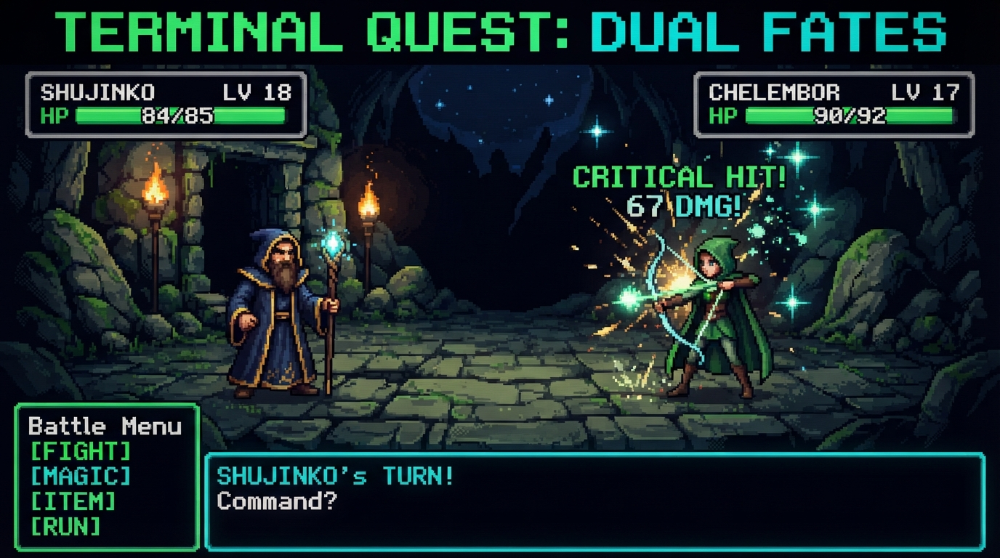

# ⚔️ Shujinko vs Chelebrimbor: Terminal RPG

> Um RPG de turnos modular desenvolvido em **Rust**, combinando uma rica mecânica de inventário dinâmico com uma interface gráfica de terminal (TUI) moderna construída utilizando a biblioteca **Ratatui**.

---

## 📸 Sobre o Projeto

Este projeto é uma jornada de evolução de um RPG de texto tradicional para uma aplicação de terminal interativa e polida. O jogador assume o papel de **Shujinko** (um Mago destemido) em um duelo tático implacável contra o elfo **Chelebrimbor**, gerenciando recursos, poções, feitiços e defesas em tempo real.

---

## ✨ Funcionalidades Principais

* **Interface TUI Moderna (`Ratatui` & `Crossterm`):** Substituição dos textos rolantes por um layout fixo dividido em blocos estéticos (Painel de Status, Histórico de Acontecimentos e Menu de Ações).
* **Sistema de Combate Tático por Turnos:** Escolha entre atacar com arma, lançar magias, defender (com redução real de dano no próximo turno) ou chamar seu mascote.
* **Inventario Dinâmico e Seguro:** Mochila interativa indexada, com uso de poções de cura, magia e estamina com verificação segura de limites (`saturating_sub`).
* **Arquitetura Modular:** Código limpo e desacoplado, dividido em módulos limpos para Herói, Inimigo e Lógica Central.

---

## 🛠️ Tecnologias Utilizadas

* **[Rust](https://www.rust-lang.org/)** - Linguagem de programação focada em segurança e alta performance.
* **[Ratatui](https://github.com/ratatui/ratatui)** - Biblioteca em Rust para criação de interfaces de usuário de terminal (TUI).
* **[Crossterm](https://github.com/crossterm-rs/crossterm)** - Biblioteca multiplataforma para manipulação de terminal e eventos de teclado.

---

## 📂 Estrutura do Projeto

```text
├── Cargo.toml          # Dependências e metadados do projeto
├── .gitignore          # Arquivos e pastas ignoradas pelo Git (/target)
└── src/
    ├── main.rs         # Loop principal, gerenciamento de estados da TUI e eventos
    ├── heroi.rs        # Structs do personagem, inventário e regras de poções
    └── inimigo.rs      # Structs e atributos do oponente (Chelebrimbor)
```
